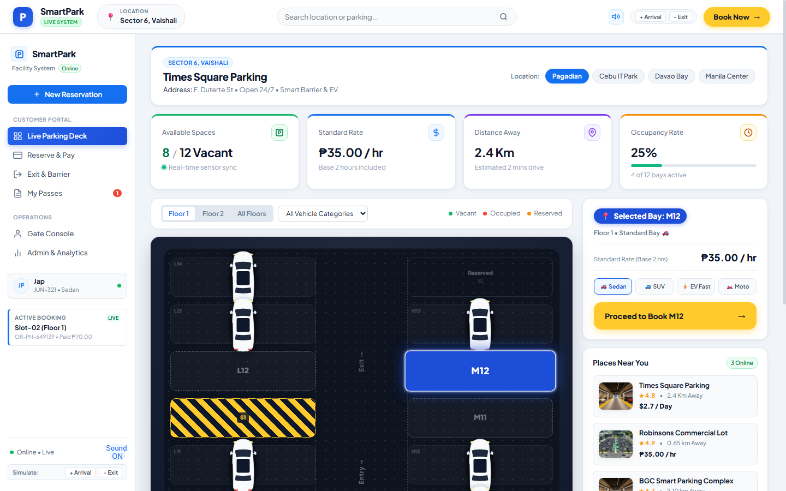
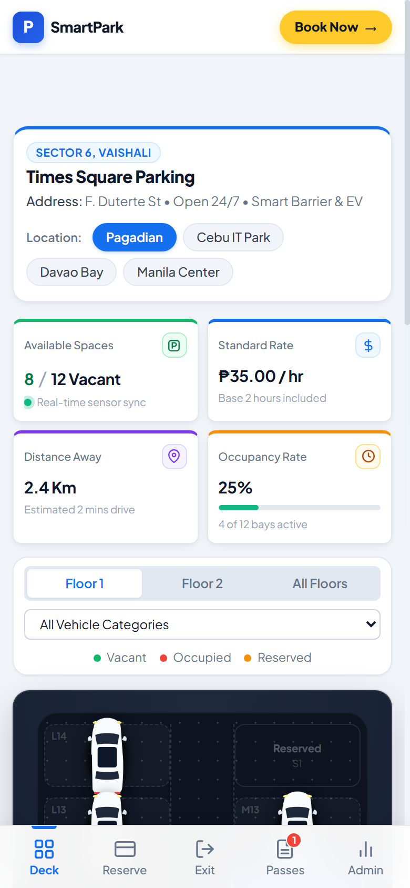

# SmartPark - Intelligent Parking Management System 🚗⚡

SmartPark is a modern, responsive web application for real-time parking space allocation, reservation management, digital ticketing, and boom barrier exit automation.

Designed with a clean, high-contrast aesthetic inspired by top modern UI/UX design patterns, featuring blueprint tarmac deck visuals, aerodynamic top-down vehicles, intuitive master-detail panels, and full mobile responsiveness.

---

## 📸 Preview

### Desktop View


### Mobile Handheld View


---

## ✨ Key Features

- **Interactive 2D Parking Deck:**
  - Real-time blueprint tarmac deck (`#0D131F`) with lane directional arrows (`Entry →`, `Exit →`).
  - Realistic aerodynamic top-down vehicle models with panoramic sunroofs and LED headlights.
  - Caution hazard diagonal stripes on maintenance/reserved stalls (`S1`).
  - Active selection highlighting in royal blue (`#1D4ED8`) with instant live synchronization.
- **Quick Booking & Reservation Flow:**
  - One-click vehicle category selection (Sedan, SUV, EV Fast Charging, Motorcycle).
  - Real-time rate calculation with standard base hours.
  - Multi-step checkout with instant plate number verification.
- **Digital QR Ticket Passes:**
  - Client-side QR code generation using `QRCode.js`.
  - Stored digital receipts with unique reservation codes (`RES-XXXXXX`), timestamps, and payment status.
- **Automated Exit Barrier Gate Simulator:**
  - Real-time ticket scan validation.
  - Animated boom barrier arm with motorized movement, green/red LED status indicators, and audio chimes.
- **Operations & Admin Dashboard:**
  - Attendant Gate Console for manual override and barrier control.
  - Facility analytics with occupancy metrics and Chart.js visualizations.
- **Multi-Facility Switching:**
  - Instant location switching across multiple parking facilities (Sector 6 Vaishali, Times Square NY, Robinsons Pagadian, BGC Smart Complex Manila).
- **IoT Event Simulator:**
  - Live simulation of random vehicle arrivals and departures to test dynamic sensor feedback.

---

## 🛠️ Technology Stack

- **Frontend:** HTML5, Modern Vanilla CSS3, JavaScript (ES6+)
- **Typography:** Google Fonts (*Plus Jakarta Sans* & *Inter*)
- **Libraries:**
  - [QRCode.js](https://davidshimjs.github.io/qrcodejs/) - QR code generation
  - [Html5-QRCode](https://github.com/mebjas/html5-qrcode) - In-browser camera barcode/QR scanner
  - [Chart.js](https://www.chartjs.org/) - Analytical dashboards
- **Audio:** Web Audio API synthesizer chimes for tactile feedback

---

## 🚀 Getting Started

No build step or external dependencies required! Simply run with any static file server:

### Option 1: Python HTTP Server (Recommended)
```bash
# In the project root directory:
python -m http.server 8085
```
Then navigate to: **`http://localhost:8085/`**

### Option 2: Node `serve` or `http-server`
```bash
npx serve .
```

### Option 3: Direct Browser Launch
Open `index.html` or `home.html` directly in any modern web browser.

---

## 📁 Project Structure

```
├── css/
│   └── style.css            # Core design system, tokens, and responsive layout
├── docs/
│   ├── preview-desktop.png  # Desktop interface screenshot
│   └── preview-mobile.png   # Mobile handheld interface screenshot
├── images/                  # Facility thumbnails and iconography
├── js/
│   ├── app.js               # Application coordinator, view switcher, and UI flows
│   ├── db.js                # LocalStorage data persistence layer
│   └── map.js               # 2D parking deck canvas renderer & vehicle SVGs
├── .gitignore               # Ignored build & OS files
├── home.html                # Main application entry
├── index.html               # Default entry point
└── README.md                # Project documentation
```

---

## 📄 License

This project is open source and available under the [MIT License](LICENSE).
